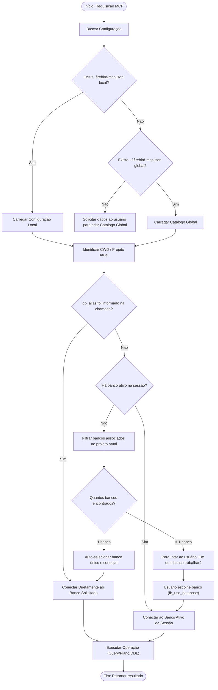

# Especificação de Requisitos — Catálogo Central de Bancos e Roteamento Contextual

**ID da Demanda:** `2026-10-16_configuracao-central-bancos`  
**Data:** 16/10/2026  
**Responsável Analítico:** Requirements Copilot  
**Status:** Em Refinamento / Descoberta  

---

## 1. MAPA DE DOMÍNIOS

| Domínio | Descrição | Nível de Confiança |
| :--- | :--- | :--- |
| **Gerenciamento de Infraestrutura MCP** | Descoberta, carregamento hierárquico e validação de configurações de bancos Firebird (Global vs Local). | **Alta** |
| **Contextualização de Projetos e Workspaces** | Associação de bancos de dados a projetos específicos (tags/metadados) para filtragem automática baseada no CWD. | **Alta** |
| **Roteamento e Governança de Sessão** | Mecanismo de escolha forçada/direcionada do banco ativo para evitar operações em bancos incorretos. | **Alta** |

---

## 2. MAPA DE STAKEHOLDERS

| Nome / Papel | Tipo | Requisitos que Defendem | Conflitos Identificados |
| :--- | :--- | :--- | :--- |
| **Desenvolvedor / DBA (Lucas)** | Usuário Final & Negócio | Arquivo único centralizado (`~/.firebird-mcp.json`), eliminação de múltiplos arquivos locais espalhados, perguntas de confirmação contextualizadas e suporte a direcionamento direto de banco em diagnósticos. | Nenhum conflito identificado. |
| **Assistente de IA (Agente MCP / Cursor / Antigravity)** | Técnico | Definição determinística de qual banco conectar, mensagens de erro claras com sugestões objetivas de bancos disponíveis por projeto. | Nenhum. |

---

## 3. ESTRUTURA DE ÉPICOS

### Épico 1: Catálogo Central Global de Bancos Firebird com Contexto de Projetos
- **Descrição:** Implementar repositório centralizado de conexões em `~/.firebird-mcp.json` permitindo metadados de projetos (`projects: ["web_projects", "erp"]`) e tags, mantendo compatibilidade retroativa com arquivos locais.
- **Complexidade Estimada:** **M** (Média — Refatoração do módulo de descoberta de configuração e serialização JSON).
- **Domínio Correspondente:** Gerenciamento de Infraestrutura MCP.

### Épico 2: Motor de Roteamento Contextual e Seleção Guiada de Banco
- **Descrição:** Mecanismo de identificação do workspace/CWD que filtra os bancos do catálogo central pertencentes ao projeto atual, exigindo seleção humana quando houver múltiplos bancos e permitindo direcionamento direto em investigações pontuais.
- **Complexidade Estimada:** **M** (Média — Filtro por contexto de pasta e extensão da ferramenta de seleção e chaveamento de banco).
- **Domínio Correspondente:** Roteamento e Governança de Sessão.

---

## 4. USER STORIES

### US01: Catálogo Global Centralizado de Bancos
- **Card:** Como desenvolvedor de software, quero manter um arquivo de configuração global único (`~/.firebird-mcp.json`) com todos os meus bancos Firebird cadastrados e vinculados aos seus respectivos projetos, para que eu não precise duplicar arquivos `.firebird-mcp.json` em cada repositório e pasta do meu ambiente.
- **Validação INVEST:**
  - **Independent:** PASS (Pode ser implementado e testado isoladamente no carregador de configuração).
  - **Negotiable:** PASS (A localização global e estrutura das chaves JSON podem ser ajustadas).
  - **Valuable:** PASS (Elimina redundância e risco de credenciais espalhadas em repositórios Git).
  - **Estimable:** PASS (Estimativa clara de 3 Story Points).
  - **Small:** PASS (Cabe confortavelmente em 1 sprint).
  - **Testable:** PASS (Testável via testes unitários de carga de arquivo).
- **Critérios de Aceite (Gherkin):**
  ```gherkin
  Cenário: Carregamento prioritário do catálogo central na ausência de arquivo local
    Dado que não existe arquivo ".firebird-mcp.json" no diretório do projeto atual
    E existe o arquivo "~/.firebird-mcp.json" com bancos cadastrados
    Quando o servidor MCP Firebird for inicializado ou recarregado
    Então o servidor deve carregar o arquivo "~/.firebird-mcp.json" como catálogo ativo
    E disponibilizar todos os bancos cadastrados para resolução.

  Cenário: Sobrescrita por arquivo local explícito
    Dado que existe um arquivo ".firebird-mcp.json" específico na pasta raiz do projeto
    E também existe o arquivo "~/.firebird-mcp.json" global
    Quando o servidor MCP Firebird iniciar
    Então o arquivo local do projeto deve ter precedência sobre o arquivo global
    E registrar nos metadados que a origem da configuração é o arquivo local.

  Cenário: Inexistência de configuração local e global
    Dado que não existe arquivo de configuração nem no projeto nem no diretório home do usuário
    Quando qualquer comando de banco for acionado
    Então o sistema deve interromper a execução e solicitar os dados ao usuário para criação do catálogo global em "~/.firebird-mcp.json".
  ```
- **Dependências:** Nenhuma dependência externa.
- **Notas Técnicas:** O caminho global padrão deve ser `Path.home() / ".firebird-mcp.json"`, respeitando também a variável `FIREBIRD_CONFIG_PATH` se definida.

---

### US02: Contextualização de Bancos por Projeto e Filtragem Inteligente
- **Card:** Como desenvolvedor trabalhando em um projeto específico, quero que o Firebird MCP identifique automaticamente os bancos vinculados ao meu projeto atual (pelo nome da pasta/workspace), para que eu veja apenas os bancos relevantes àquele contexto e evite selecionar bancos de outros sistemas acidentalmente.
- **Validação INVEST:**
  - **Independent:** PASS (Depende apenas da US01 para ler a lista de bancos).
  - **Negotiable:** PASS (Formato da tag de projeto pode ser array de strings ou globs).
  - **Valuable:** PASS (Reduz ruído cognitivo e risco operacional).
  - **Estimable:** PASS (2 Story Points).
  - **Small:** PASS (Escopo cirúrgico).
  - **Testable:** PASS (Testável em diretórios simulados).
- **Critérios de Aceite (Gherkin):**
  ```gherkin
  Cenário: Filtragem automática por pasta do projeto
    Dado que o catálogo global contém bancos para "web_projects" e bancos para "pdv_loja"
    E o diretório de trabalho atual do processo (CWD) é "/home/lucas/web_projects"
    Quando a ferramenta "fb_list_databases" for executada
    Então o retorno deve destacar os bancos cujo campo "projects" contenha "web_projects" (ou projetos correspondentes ao CWD)
    E sinalizar quantos bancos pertencem ao projeto ativo.

  Cenário: Banco sem restrição de projetos (Global/Coringa)
    Dado que um banco possui a propriedade "projects" vazia ou contendo "*"
    Quando qualquer projeto listar os bancos
    Então esse banco coringa deve ser visível e selecionável em qualquer contexto.
  ```
- **Dependências:** US01.
- **Notas Técnicas:** Utilizar `Path.cwd().name` e comparação com o array de projetos de cada banco.

---

### US03: Seleção Guiada Obrigatória em Projetos com Múltiplos Bancos
- **Card:** Como desenvolvedor em um projeto que utiliza múltiplos bancos (ex: principal e auditoria), quero ser explicitamente questionado sobre qual banco utilizar antes de qualquer operação sem alias, para que eu tenha certeza absoluta de onde as consultas e modificações estão sendo executadas.
- **Validação INVEST:**
  - **Independent:** PASS (Aperfeiçoamento da regra de negócio de sessão já existente).
  - **Negotiable:** PASS.
  - **Valuable:** PASS (Segurança máxima de dados).
  - **Estimable:** PASS (2 Story Points).
  - **Small:** PASS.
  - **Testable:** PASS.
- **Critérios de Aceite (Gherkin):**
  ```gherkin
  Cenário: Pergunta obrigatória quando múltiplos bancos estão associados ao projeto
    Dado que o projeto atual possui 2 bancos cadastrados no catálogo ("erp_principal" e "erp_auditoria")
    E o usuário ainda não escolheu um banco ativo na sessão
    Quando uma consulta de leitura ou inspeção for invocada sem o parâmetro "db_alias"
    Então a execução deve ser bloqueada com mensagem estruturada
    E o agente deve perguntar interativamente ao usuário em qual dos bancos do projeto deseja trabalhar.

  Cenário: Ativação da escolha via comando de sessão
    Dado que o usuário respondeu que deseja trabalhar no banco "erp_auditoria"
    Quando a ferramenta "fb_use_database('erp_auditoria')" for chamada
    Então todas as operações subsequentes da sessão sem "db_alias" devem executar contra "erp_auditoria".
  ```
- **Dependências:** US01, US02.
- **Notas Técnicas:** Mantém o controle de `session_selected_alias` na memória do servidor.

---

### US04: Direcionamento Direto para Investigações de Casos Específicos
- **Card:** Como analista investigando um incidente ou chamado específico, quero poder direcionar o MCP imediatamente para qualquer banco do catálogo global (através do parâmetro `db_alias` ou comando direto), para que eu não perca tempo trocando de contexto ou configurando arquivos locais quando precisar inspecionar uma base legada ou secundária.
- **Validação INVEST:**
  - **Independent:** PASS.
  - **Negotiable:** PASS.
  - **Valuable:** PASS (Agilidade crítica em chamados de suporte/produção).
  - **Estimable:** PASS (1 Story Point).
  - **Small:** PASS.
  - **Testable:** PASS.
- **Critérios de Aceite (Gherkin):**
  ```gherkin
  Cenário: Direcionamento direto via parâmetro db_alias
    Dado que o usuário está no projeto "web_projects"
    E precisa investigar um chamado em "pdv_loja1" presente no catálogo global
    Quando invocar "fb_query(sql='SELECT * FROM RDB$DATABASE', db_alias='pdv_loja1')"
    Então a consulta deve ser executada com sucesso contra o banco "pdv_loja1" sem exigir mudança de projeto ou arquivo local.

  Cenário: Busca inteligente por apelido ou descrição parcial
    Dado que existem os bancos "erp_principal", "erp_auditoria" e "pdv_loja1"
    Quando a ferramenta "fb_use_database" for acionada com "auditoria"
    Então o MCP deve reconhecer o alias correspondente "erp_auditoria" e ativá-lo na sessão.

  Cenário: Solicitação do usuário indicando o banco diretamente no prompt
    Dado que existem múltiplos bancos configurados no catálogo global
    Quando o usuário pedir explicitamente no chat "investigar o bug no banco de auditoria" ou "consultar dados no banco pdv"
    Então o assistente/MCP deve resolver a menção ao banco ("erp_auditoria" ou "pdv_loja1") e executar a conexão diretamente
    E não deve fazer perguntas redundantes de confirmação ao usuário.
  ```
- **Dependências:** US01.
- **Notas Técnicas:** Suporte a match exato e fallback para busca case-insensitive por substring nos aliases e tags. Atualização das diretrizes do assistente para reconhecimento de menções explícitas de banco no prompt do usuário.

---

## 5. PERGUNTAS EM ABERTO E RESOLUÇÕES

| ID | Pergunta Direta | Impacto se não clarificado | Status | Resolução Confirmada |
| :--- | :--- | :--- | :--- | :--- |
| **P01** | Como o MCP deve inferir o projeto atual: pelo nome da pasta raiz (`Path.cwd().name`), pelo caminho absoluto ou por um parâmetro opcional informado pelo usuário/IDE? | Se for apenas pelo nome da pasta (`web_projects`), duas pastas com mesmo nome em diretórios diferentes seriam tratadas como o mesmo projeto. | **RESOLVIDA** | Inferência automática pelo nome da pasta do CWD (`Path.cwd().name`), com opção de sobrescrita manual via parâmetro/ambiente quando necessário. |
| **P02** | Quando o usuário adicionar um novo banco com `fb_configure_database`, o salvamento padrão deve ser no catálogo global (`~/.firebird-mcp.json`) ou no local? | Risco de gravar conexões locais no global ou vice-versa. | **RESOLVIDA** | Salvar por padrão no Catálogo Global Central (`~/.firebird-mcp.json`), incluindo automaticamente o nome do projeto atual na lista de `"projects"`. |
| **P03** | No catálogo global, quando um banco não tiver a chave `"projects"` definida, ele deve ser considerado visível para **todos** os projetos ou para **nenhum** até que seja vinculado? | Afeta o ruído de exibição na lista de bancos ao abrir novos projetos. | **RESOLVIDA** | Considerado banco compartilhado globalmente, visível e selecionável para todos os projetos do ambiente. |
| **P04** | Para investigações pontuais de outros projetos, a busca por alias deve aceitar correspondência parcial (ex: digitar apenas `auditoria` para selecionar `erp_auditoria`)? | Facilita a usabilidade do desenvolvedor ao interagir com o assistente. | **RESOLVIDA** | Sim, implementar resolução inteligente de alias por correspondência exata prioritária e por substring / tag como fallback. |
| **P05** | Quando o usuário indicar diretamente o banco na sua solicitação (ex: "investigar bug no banco de auditoria"), como o assistente/MCP deve se comportar? | Evita fricção desnecessária e perguntas redundantes quando a intenção do usuário já foi explicitada no prompt. | **RESOLVIDA** | Direcionar a operação imediatamente para o banco indicado (via `db_alias` ou ativando com `fb_use_database`), sem fazer perguntas de confirmação. A pergunta só deve ocorrer se a consulta for genérica e o banco não tiver sido indicado. |

---

## 6. FLAGS DE RISCO

- `[ESPECIFICAÇÃO INVENTADA]`: Caminho padrão `~/.firebird-mcp.json` para o catálogo global `[A CONFIRMAR COM STAKEHOLDER]`.
- `[VIABILIDADE TÉCNICA SILENCIOSA]`: Em containers Docker com volume restrito (`-v ${workspaceFolder}:/workspace`), o caminho do home do host (`~/.firebird-mcp.json`) não é acessível a menos que montado explicitamente via `-v ~/.firebird-mcp.json:/root/.firebird-mcp.json`.
- `[DEPENDÊNCIA NÃO MAPEADA]`: Dependência de permissão de escrita no diretório do usuário em ambientes corporativos com perfil restrito.
- `[GOLD PLATING]`: Suporte a expressões regulares ou globs complexos no campo `"projects"` foi descartado nesta fase inicial, mantendo array de strings simples para evitar complexidade desnecessária.

---

## 7. CARDS PRONTOS PARA JIRA

---
**Épico:** Catálogo Central Global de Bancos Firebird com Contexto de Projetos  
**Feature:** Repositório Central de Configuração  
**Título:** Como desenvolvedor, quero manter um arquivo de configuração global único (~/.firebird-mcp.json)  
**Tipo:** Story  
**Story Points:** 3 — Implementação da resolução hierárquica de arquivos de configuração (Explícito > Local > Global).  
**Sprint:** Sprint 1  
**Component/s:** firebird_mcp.connection  
**Labels:** infraestrutura, mcp, M  

**Para que:** Eliminar a necessidade de arquivos locais replicados em cada repositório e centralizar as credenciais dos bancos de dados da máquina.  

**Critérios de Aceite:**  
Cenário: Resolução do arquivo global  
  Dado que não existe .firebird-mcp.json local no workspace  
  Quando o MCP inicializar  
  Então deve carregar as conexões de ~/.firebird-mcp.json.  

Cenário: Precedência do arquivo local  
  Dado que existe .firebird-mcp.json local  
  Quando o MCP inicializar  
  Então deve carregar o arquivo local preferencialmente ao global.  

**Dependências:** Nenhuma.  
**Definition of Ready:** ✅ INVEST validado.  
---

---
**Épico:** Motor de Roteamento Contextual e Seleção Guiada de Banco  
**Feature:** Contextualização e Filtragem por Projeto  
**Título:** Como desenvolvedor, quero que o MCP identifique os bancos vinculados ao meu projeto atual  
**Tipo:** Story  
**Story Points:** 2 — Mecanismo de match entre CWD e metadados de projetos no JSON.  
**Sprint:** Sprint 1  
**Component/s:** firebird_mcp.connection, firebird_mcp.server  
**Labels:** contexto, seguranca, M  

**Para que:** Exibir ao desenvolvedor apenas os bancos pertencentes ao sistema em que ele está codificando, reduzindo erros humanos.  

**Critérios de Aceite:**  
Cenário: Listagem filtrada por projeto  
  Dado que o CWD é "/home/lucas/web_projects"  
  Quando "fb_list_databases" for chamado  
  Então deve agrupar ou priorizar bancos que possuam "web_projects" em seus "projects".  

Cenário: Bloqueio e solicitação de escolha em multi-bancos do projeto  
  Dado que o projeto possui múltiplos bancos vinculados e nenhum ativo  
  Quando qualquer comando de leitura for executado sem db_alias  
  Então deve barrar a execução e exigir a escolha do banco.  

**Dependências:** US01.  
**Definition of Ready:** ✅ INVEST validado.  
---

---
**Épico:** Motor de Roteamento Contextual e Seleção Guiada de Banco  
**Feature:** Direcionamento Direto em Investigações  
**Título:** Como analista, quero direcionar o MCP diretamente para qualquer banco do catálogo global  
**Tipo:** Story  
**Story Points:** 1 — Bypass de contexto quando db_alias explícito é fornecido.  
**Sprint:** Sprint 1  
**Component/s:** firebird_mcp.connection, firebird_mcp.server  
**Labels:** operacao, suporte, P  

**Para que:** Permitir investigações rápidas de chamados em bancos secundários ou de outros projetos sem trocar de pasta ou reconfigurar arquivos.  

**Critérios de Aceite:**  
Cenário: Consulta direta com db_alias  
  Dado um banco existente no catálogo global  
  Quando executado fb_query com db_alias correspondente  
  Então a conexão deve ser estabelecida imediatamente para aquele banco.  

**Dependências:** US01.  
**Definition of Ready:** ✅ INVEST validado.  
---

---

## 8. DEPENDÊNCIAS NÃO DECLARADAS

| Dependência | User Story Bloqueada | Ação Necessária |
| :--- | :--- | :--- |
| **Configuração do Docker (`docker-compose.yml` e `args` no MCP)** | US01 | Para usuários que rodam o MCP via container Docker, o arquivo global `~/.firebird-mcp.json` precisará ser montado no container via volume no `docker run` / `docker-compose`. |
| **Normalização do Nome do Projeto** | US02 | Definir algoritmo de casamento (ex: `Path.cwd().name.lower()` comparado com `p.lower()`). |

---

## 9. DIAGRAMA DE FLUXO (Mermaid)



---

> ⚠️ *Este output é um rascunho analítico. Requer revisão humana antes de entrar em sprint. Valide: viabilidade técnica, compliance/LGPD e dependências não mapeadas.*
